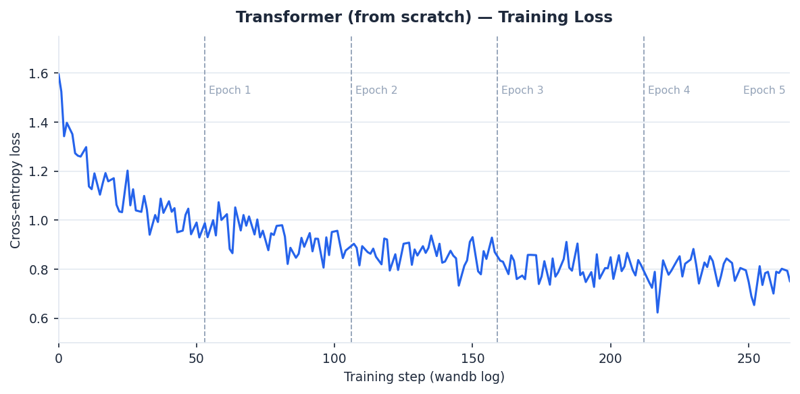
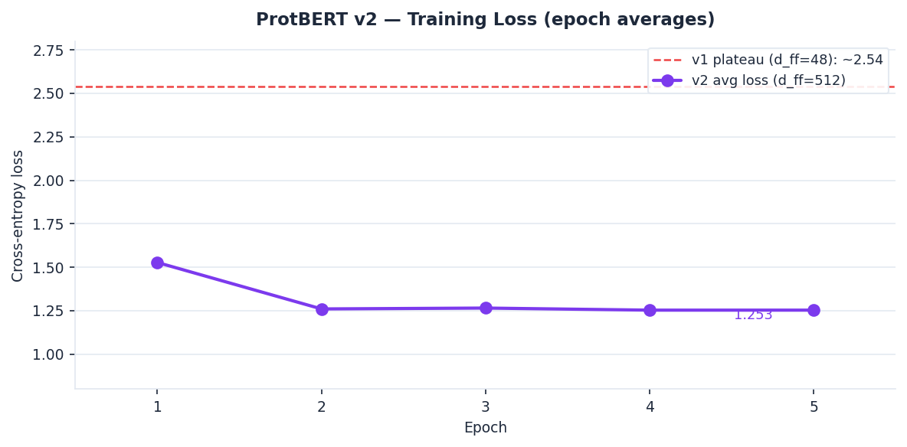

# Protein-Specific-Drug-Generation

This project is inspired by [this paper](https://www.nature.com/articles/s41598-020-79682-4), which implements a transformer neural network for protein-specific drug generation. Based on a amino acid sequence of a protein target, the goal is to find the SMILES representation of a suitable drug. The goal of this project is to compare the performance of different model architectures on this task. The evaluated models are those capable of understanding sequence data, such as transformer structures like in the referenced paper, trained from scratch or by fine-tuning existing LLMs, as well as LSTM and RNN models.

## Data processing
The data used is the same as in the referenced paper: BindingDB, which contains measured binding affinities of interactions between proteins and drug-like molecules. The proteins were filtered to ensure no missing values, and to include only those from humans, rats, mice, or tauruses, and of medium size. Each element of the amino acid sequence and SMILES sequence is then encoded.

## Models and results

Different model architectures capable of understanding sequence-like data were trained and compared on a test set. The dataset consists of 337,459 protein–SMILES pairs from BindingDB; each model was trained on a subset (see architecture details below).

### Transformer (trained from scratch)

An encoder-decoder transformer with the following architecture was trained from scratch:

| Hyperparameter | Value |
|---|---|
| `d_model` | 128 |
| `num_heads` | 2 |
| `num_encoder_layers` | 2 |
| `num_decoder_layers` | 2 |
| `d_ff` | 256 |
| `dropout` | 0.1 |
| Parameters | 687,295 |
| Optimizer | Adam (lr=1e-4) |
| Batch size | 16 (dynamic padding) |

Training used **dynamic per-batch padding** (each batch padded to its own max length) on ~168K pairs (1/6 of the dataset). Training ran for **5 epochs** (~3h 15min on a T4 GPU, 105,455 total steps).

**Training loss curve:**

| Epoch | Avg Loss | TF Accuracy |
|---|---|---|
| 1 | 1.145 | 66% |
| 2 | 0.937 | 71% |
| 3 | 0.869 | 74% |
| 4 | 0.824 | 74% |
| 5 | 0.793 | 75% |

**Held-out evaluation (greedy decoding):**

| Metric | Validation | Test |
|---|---|---|
| TF loss | 0.872 | 0.829 |
| TF accuracy | 69.8% | 70.9% |
| SMILES validity (RDKit) | 46.2% | 57.0% |
| Exact match | 0% | 0% |

SMILES validity measures the fraction of generated sequences that parse as chemically valid molecules according to RDKit. The ground-truth sequences are 100% valid. Exact match is 0% as expected for this open-ended generation task.

**Qualitative observations:** The model generates drug-like scaffolds such as biaryl amides, piperidine/piperazine-containing compounds, and heteroaromatic kinase inhibitor-like structures. Remaining failure modes include occasional degenerate outputs (long alkane chains) and mode collapse under greedy decoding (the same scaffold generated for multiple different protein inputs).

### ProtBERT (encoder fine-tuning)

[ProtBert](https://huggingface.co/Rostlab/prot_bert) from the HuggingFace library was used as the encoder. It is specifically pre-trained on amino acid sequences in a self-supervised fashion (masked token prediction). An attention-based decoder was added; in the first iteration only the decoder weights were trained while the ProtBERT encoder was frozen (420M frozen parameters).

**Architecture (v2):**

| Hyperparameter | Value |
|---|---|
| Encoder | ProtBERT (frozen) |
| `d_model` | 1024 (matches ProtBERT output) |
| `num_heads` | 4 |
| `num_decoder_layers` | 2 |
| `d_ff` | 512 |
| `dropout` | 0.1 |
| Trainable params | ~6.3M (decoder only) |
| Optimizer | Adam (lr=1e-3) |
| Batch size | 64 (dynamic padding) |
| Subsample | 1/12 of data (~28K pairs) |

An interesting finding from this experiment: a small `d_ff` value creates a severe FFN bottleneck (1024→48→1024) that causes complete mode collapse — the model generates the same degenerate sequence for every input, regardless of training duration or other hyperparameters. Increasing `d_ff` to 512 resolved this entirely and yielded a ~51% reduction in loss compared to the bottlenecked configuration.

Training ran for **5 epochs** (~75 min/epoch on a T4 GPU, ~6.25h total, 439 batches/epoch).

**Training loss curve:**

| Epoch | Avg Loss | TF Accuracy |
|---|---|---|
| 1 | 1.527 | ~50% |
| 2 | ~1.26 | ~55% |
| 3 | 1.265 | ~56% |
| 4 | ~1.253 | ~56% |
| 5 | **1.253** | ~56% |

**Qualitative inference results (greedy decoding, 5 test examples):**

Mode collapse was fully resolved — the model generates diverse SMILES with valid drug-like fragments. However, greedy decoding causes repetitive carbon-chain runoff after ~20 tokens; temperature or nucleus (top-p) sampling is expected to resolve this.

| Metric | Value |
|---|---|
| Mode collapse | None (resolved) |
| Char overlap (greedy) | 10–24% |
| Drug-like prefix generation | Yes |

Selected examples (protein input truncated to first 40 aa):

| Protein (40aa) | Ground truth SMILES | Generated SMILES |
|---|---|---|
| `MKHQHQHQHQ...` | `CC(C)(C)c1ccc(cc1)S(=O)(=O)N1CCCN(CC1)c1ncccc1C(F)(F)F` | `CC(C)(C)(C)(CCCCCCCCCCCCCCC...` |
| `MEVQLGLGRV...` | `CCCCN(CC(F)(F)F)c1ccc2[nH]c(=O)cc(c2c1)C(F)(F)F` | `CC(C)C[C@H]1(CCCCCCCCCCCCCC...` |
| `MQYLNIKEDC...` | `CCc1cc(O)c(F)cc1-c1ccc2c(n[nH]c2c1)-c1nc2CN(CCc2[nH]1)C(=O)...` | `CC(C)(C)(CC(=O)N1CC(=O)c2cc...` |
| `MLRAAARFGP...` | `CS(=O)(=O)Nc1ccc(cc1)-c1coc2cc(ccc2c1=O)C#CC1CN(C1)C(=O)OC1CCCC1` | `CC(=O)C(=O)N1CCCCCCCCCCCCCC...` |
| `MAQKENSYPW...` | `COc1cc(ccn1)C(=O)NC1=CCCC(=C1)C(C)Nc1ncnc2c(cccc12)C(N)=O` | `CC(C)(C)CC(=O)Nc1ccccccccccc...` |

The model correctly learns drug-like prefixes (methyl groups, ring starters, amide bonds) but then collapses into long carbon chains under greedy decoding.

**Held-out evaluation (greedy decoding):**

| Metric | Validation | Test |
|---|---|---|
| TF loss | 1.407 | 1.368 |
| TF accuracy | 52.2% | 53.5% |
| SMILES validity (RDKit) | 7.5% | 9.0% |
| Exact match | 0% | 0% |

SMILES validity is very low because greedy decoding reliably collapses into repetitive `c` tokens after a valid drug-like prefix, producing unclosed rings that RDKit cannot parse. Temperature or nucleus sampling is expected to substantially improve this.

---

## Model comparison

Both models were evaluated with teacher-forced (TF) loss and accuracy on the full held-out splits, and SMILES validity via RDKit on 200 greedy-decoded samples per split.

| Metric | Transformer (scratch) | ProtBERT v2 |
|---|---|---|
| Trainable params | 687K | ~6.3M decoder (+420M frozen) |
| Training pairs | ~168K | ~28K |
| Val TF loss | **0.872** | 1.407 |
| Test TF loss | **0.829** | 1.368 |
| Val TF accuracy | **69.8%** | 52.2% |
| Test TF accuracy | **70.9%** | 53.5% |
| Val SMILES validity | **46.2%** | 7.5% |
| Test SMILES validity | **57.0%** | 9.0% |
| Exact match | 0% | 0% |

**Conclusion:** The scratch transformer outperforms ProtBERT v2 on every metric by a large margin. The most striking gap is in SMILES validity: 46–57% vs 7–9%. The main contributing factors are:

1. **Training data volume**: the scratch transformer saw 6× more pairs (168K vs 28K). ProtBERT v2 was trained on a 1/12 subsample, which is not enough for the decoder to learn reliable SMILES generation.
2. **Greedy decoding runoff**: ProtBERT v2's higher TF loss (~1.4 vs 0.87) reflects weaker next-token calibration — greedy decoding almost always hits the 120-token ceiling with an unclosed ring, failing RDKit validation.
3. **Task mismatch**: ProtBERT's representations are not fine-tuned for drug generation (encoder is frozen), so the decoder must bridge a larger representational gap.

The scratch transformer result suggests that training data volume matters more than encoder quality at this scale under greedy decoding. ProtBERT v2 would likely close the gap with more training data and nucleus or beam-search decoding.

---

## Potential next steps

- **Sampling strategies**: Replace greedy decoding with temperature or nucleus (top-p) sampling to address mode collapse and improve output diversity.
- **Scheduled sampling**: Training uses teacher forcing, which creates a mismatch with auto-regressive inference ("exposure bias"). Scheduled sampling (Bengio et al., 2015) gradually shifts from feeding ground-truth tokens to the model's own predictions during training, which could improve generation quality especially for longer SMILES sequences.
- **SMILES validity filtering**: Post-process generated sequences with RDKit and re-sample invalid ones.
- **Drug-likeness metrics**: Evaluate generated molecules on QED (quantitative estimate of drug-likeness) and SA score (synthetic accessibility), not just SMILES validity.
- **More training**: The val loss (0.872) is still well above 0.5, and the model shows no sign of overfitting (train–val gap is small). Additional epochs or a larger architecture (`d_model=256`, more layers) would likely improve both validity and diversity, though larger models were not explored here due to GPU memory and compute constraints on free-tier Colab (single T4).
- **ProtBERT fine-tuning**: Unfreeze the ProtBERT encoder and fine-tune end-to-end, which should produce better protein representations and improve conditioning.
- **Binding affinity evaluation**: Use docking software (e.g. AutoDock Vina) or a pre-trained affinity predictor to assess whether generated molecules are actually predicted to bind the input protein.
